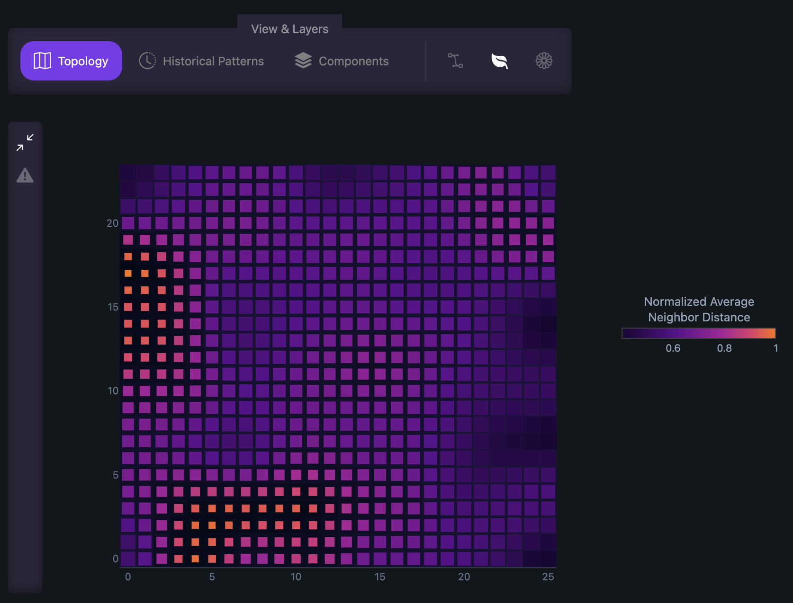
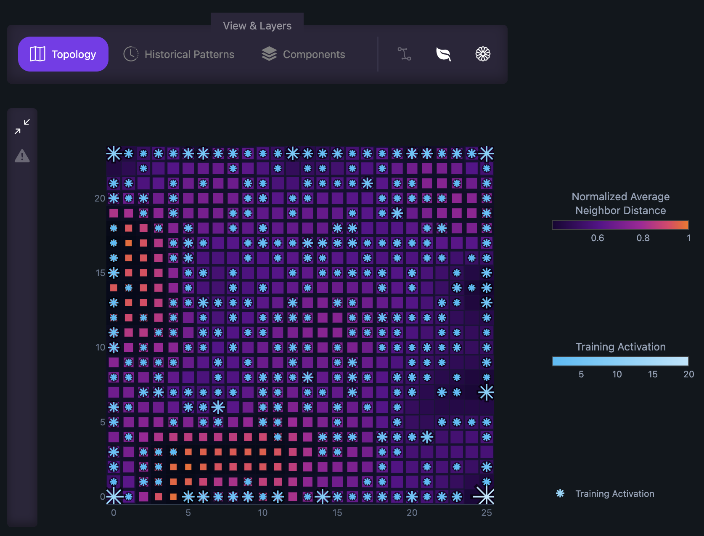
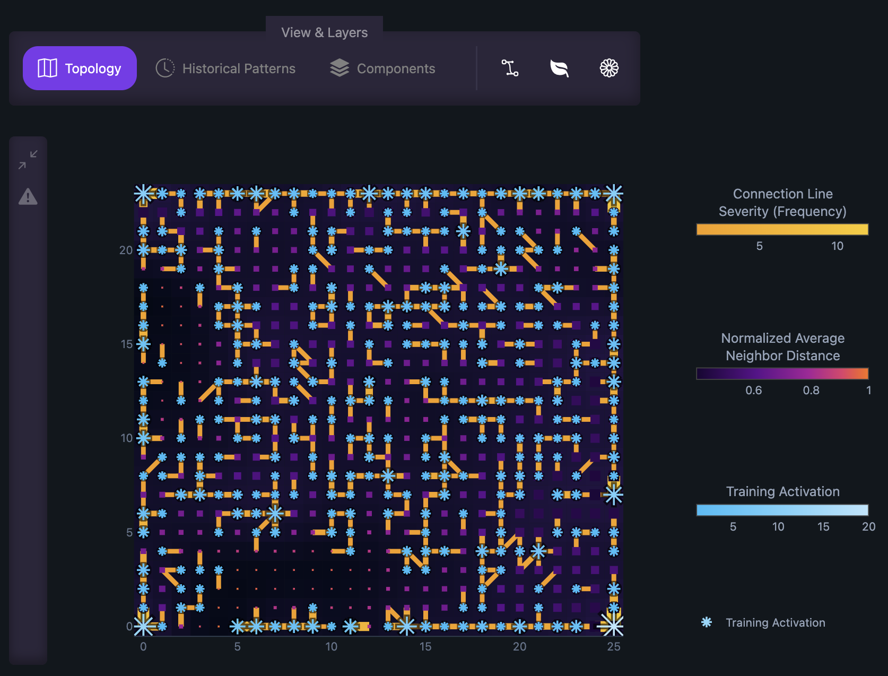
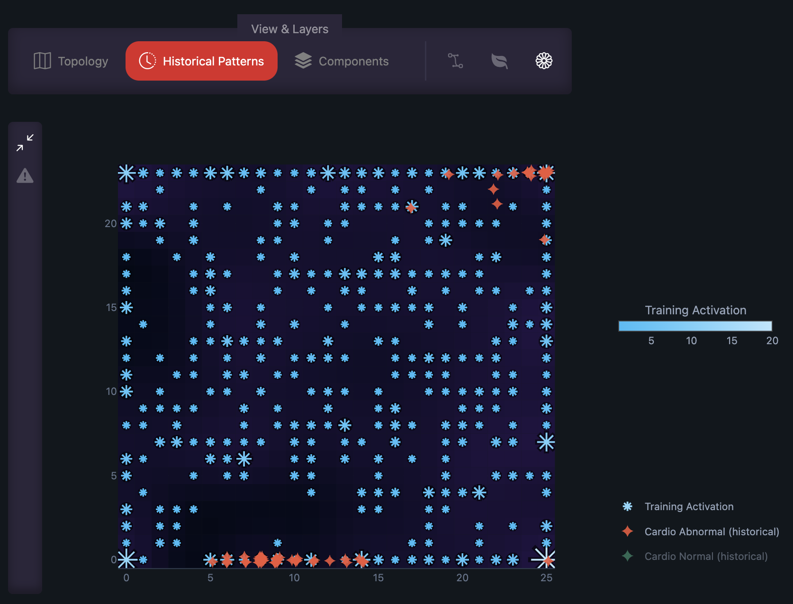
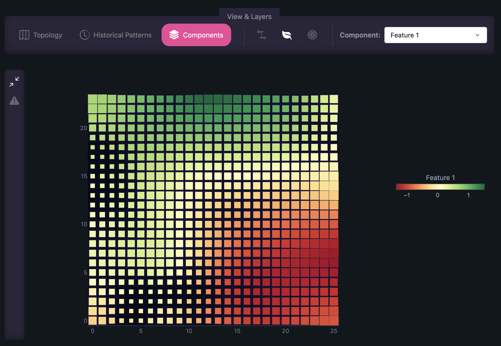
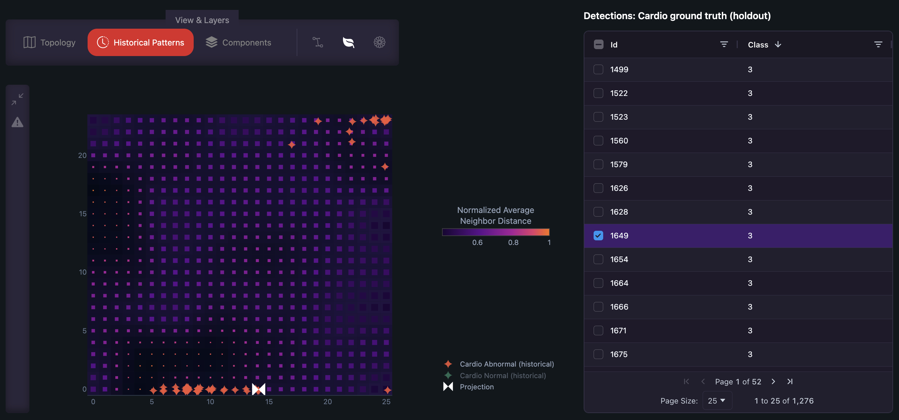

# Core Features

The core of Bianor is the **Map Explorer**, designed to visualize trained Self-Organizing Map (SOM) topologies, projections, and predictions with responsive layer controls.

=== ":material-map: Topology View"

    Displays the topology of the trained Self-Organizing Map in 2D space. Analytical layers can be combined and toggled:

    === "Neighbor Distances"

        Visualizes distance between adjacent nodes to distinguish dense clusters from sparse boundaries.

        

    === "Training Activations"

        Overlays node activation frequencies to inspect training sample density across clusters.

        

    === "Full Topological Connections"

        Renders connection lines between first and second best-matching nodes of training data, revealing grid continuity, map quality, data complexity, and dispersion.

        

=== ":material-clock: Historical Patterns"

    Visualizes historical sample projections mapped directly onto the trained topology.

    

=== ":material-clock: Component View"

    Visualizes the component value of the map nodes based on a single selected feature.

    

=== ":material-radar: Predictions"

    Projects external predictions onto the topology to identify surrounding patterns.

    

---

## Next Steps

- Check the [Prerequisites](individual/prerequisites.md) to set up Bianor in your workspace.
- Follow the [Launch Guide](individual/launch.md) to deploy your application.
- Learn how to train and link models in [Modeling & Configuration](individual/modeling.md).
