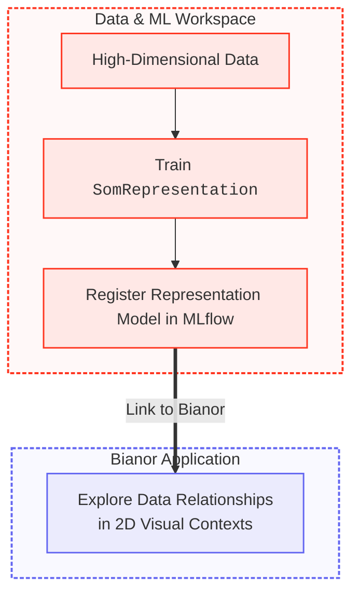

  
  

**Bianor** is an interactive app for exploring and contextualizing high-dimensional data via Self-Organizing Map (SOM) representations.

---

## Architecture at a Glance

Bianor integrates with **Databricks**: data in _Unity Catalog_, models in _MLflow_.
A fully **local workflow** is also available when you do not need a Databricks connection.

---

## Get Started

-   :material-account-school:{ .lg .middle } __Community Edition__

    ---

    Designed for individual **researchers**, **data scientists**, and **curious minds**. Explore high-dimensional representations.

    * [Core Features](features.md)
    * [Prerequisites](individual/prerequisites.md)
    * [Launch Bianor](individual/launch.md)
    * [Modeling & Configuration](individual/modeling.md)

-   :material-domain:{ .lg .middle } __Biome Edition__

    ---

    Designed for **organizations** and **data teams** with established Databricks workspaces.

    * For early access or assistance, reach out at [hello@ophelia-rnd.dev](mailto:hello@ophelia-rnd.dev)

