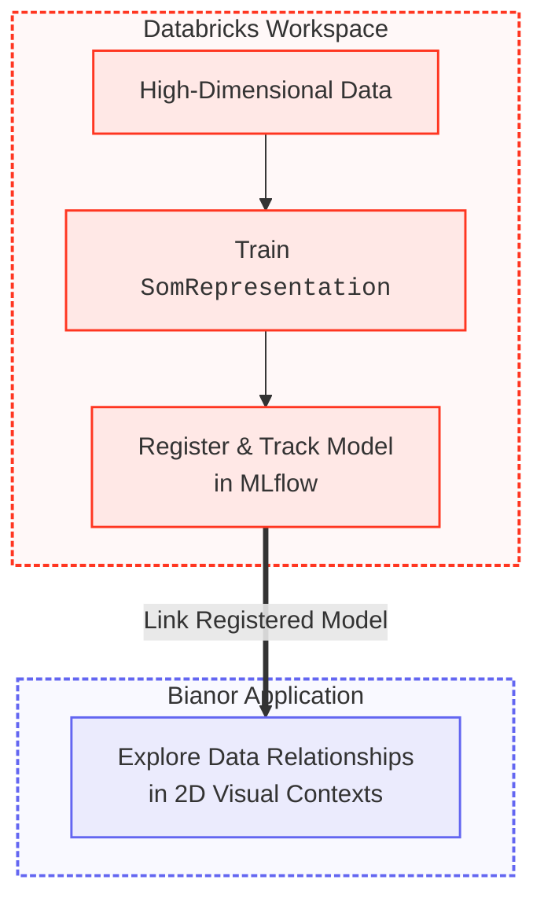

  
  

# Bianor Documentation

**Bianor** is an installable **Databricks App** designed for interactive exploration and contextualization of high-dimensional data and Self-Organizing Map (SOM) representations residing in your Databricks workspace.

---

## Architecture at a Glance

Bianor is purpose-built for the Databricks ecosystem. It natively relies on data residing in Unity Catalog and models registered through MLflow. However, the Bianor application itself can be run either deployed as a native Databricks App or executed locally on your workstation.

---

## Get Started

Choose the edition that best matches your environment and goals:

-   :material-account-school:{ .lg .middle } __Community Edition__

    ---

    Designed for individual **researchers, data scientists, and curious minds**. Explore high-dimensional representations with a free Databricks account.

    * [Prerequisites](individual/setup.md)
    * [Launch Bianor](individual/run.md)

-   :material-domain:{ .lg .middle } __Biome Edition__

    ---

    Designed for **organizations and data teams** with established Databricks workspaces.

    * For early access or assistance, reach out at [hello@ophelia-rnd.dev](mailto:hello@ophelia-rnd.dev).

