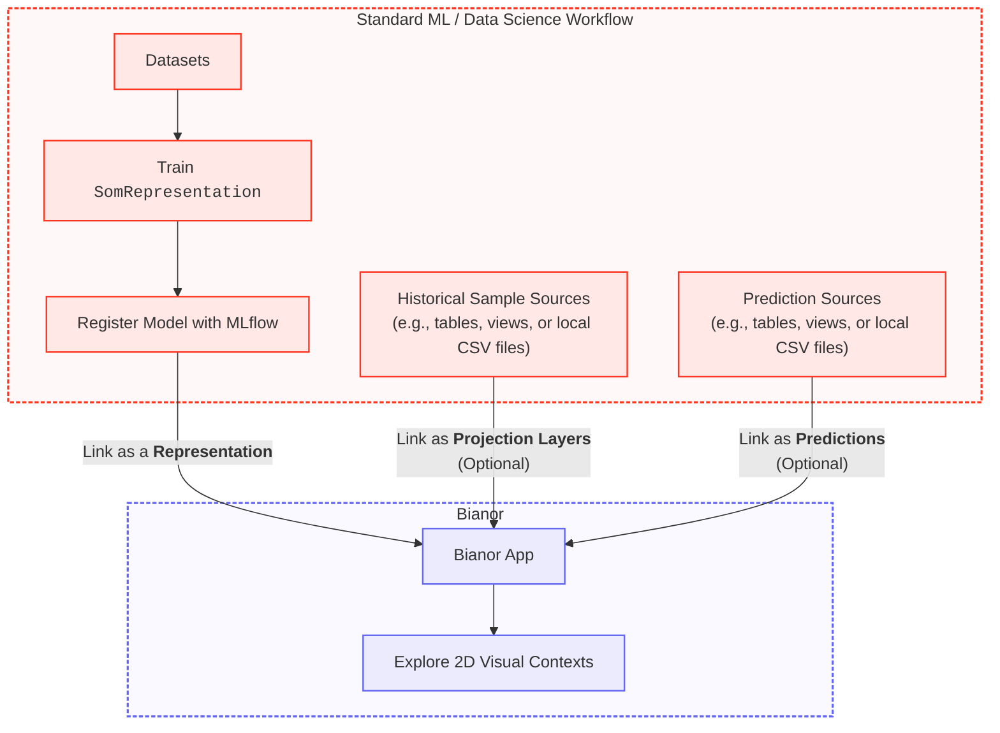

# Community Edition &mdash; Modeling & Configuration

## Overview

The model lifecycle in Bianor is decoupled from the application. You train and manage Self-Organizing Map representations using your standard workflows and link them to Bianor.



---

## Instructions

=== ":simple-databricks: Databricks App"

    ### 1. Prerequisites

    Open a notebook in your Databricks workspace. Ensure you have installed the companion libraries:

    ```bash
    pip install minisom-representation bianor-databricks-kit
    ```

    * [`ophelia-rnd/minisom-representation`](https://github.com/ophelia-rnd/minisom-representation): Trains 2D Self-Organizing Map (SOM) representations on high-dimensional data.
    * [`ophelia-rnd/bianor-databricks-kit`](https://pypi.org/project/bianor-databricks-kit/): Assists in creating metadata tables and linking registered models, projection layers, and predictions to Bianor.

    ---

    ### 2. Modeling

    #### 2.1 Train a Representation

    Train a `SomRepresentation` model using `minisom-representation`:

    ```python
    from sklearn.datasets import load_iris
    from sklearn.preprocessing import StandardScaler
    from minisom_representation import SomRepresentation

    # 1. Prepare and scale data
    X, _ = load_iris(return_X_y=True)
    scaler = StandardScaler()
    X_scaled = scaler.fit_transform(X)

    # 2. Initialize with derived hyperparameters and fit
    som_rep = SomRepresentation.with_derived_params(X_scaled, initial_sigma_factor=2.0, distance_map_scaling="mean", random_seed=42)
    som_rep.fit_online(X_scaled, num_iteration=20, use_epochs=True, random_order=True)
    ```

    Using `with_derived_params` is a quick start to learn a representation. For advanced usage and custom training options, refer to the examples in the [`minisom-representation`](https://github.com/ophelia-rnd/minisom-representation) repository.

    #### 2.2 Register the Representation as a Model

    Register the trained representation in Databricks via MLflow:

    ```python
    catalog = "workspace"
    schema = "bianor"
    model_name = "iris-som"
    full_model_name = f"{catalog}.{schema}.{model_name}"
    ```

    ```python
    from mlflow.pyfunc import PythonModel
    class MLflowSomModelWrapper(PythonModel):
        def __init__(self, model: SomRepresentation, scaler):
            self.model = model
            self.scaler = scaler
    ```

    ```python
    import pandas as pd
    import mlflow
    from mlflow.models import infer_signature

    # Configure MLflow for Unity Catalog
    mlflow.set_registry_uri("databricks-uc")

    with mlflow.start_run() as run:
        model = MLflowSomModelWrapper(som_rep, scaler)

        # Infer signature with dummy output to satisfy Unity Catalog requirement
        signature = infer_signature(pd.DataFrame(X[:1]), pd.DataFrame({"dummy": [0]}))

        # Optionally, log representation quality metrics
        mlflow.log_metric("QE", som_rep.quantization_error)
        mlflow.log_metric("TE", som_rep.topographic_error)

        mlflow.pyfunc.log_model(
            python_model=model,
            name=model_name,
            signature=signature,
            pip_requirements=[
                "scikit-learn",
                "minisom-representation",
            ],
            registered_model_name=full_model_name
        )
    ```

    ---

    ### 3. Configuration

    Use the [`bianor-databricks-kit`](https://pypi.org/project/bianor-databricks-kit/) to register the representation and configure layers for Bianor.

    #### 3.1 Initialize the Bianor Environment (One-time)

    If you haven't already initialized your target schema tables, run:

    ```python
    from bianor_databricks_kit import BianorSetupManager

    bianor_setup = BianorSetupManager(catalog=catalog, schema=schema, spark=spark)
    bianor_setup.setup()
    ```

    This creates the required Databricks metadata tables:
    - `BIANOR_REPRESENTATION`
    - `BIANOR_PROJECTION_LAYER`
    - `BIANOR_PREDICTION`
    - `BIANOR_MAP_REPRESENTATION_PROJECTION_LAYER`
    - `BIANOR_MAP_REPRESENTATION_PREDICTION`

    #### 3.2 Link the Representation to Bianor

    Link your registered MLflow model and its features source:

    ```python
    from bianor_databricks_kit import BianorRecordManager

    recorder = BianorRecordManager(catalog=catalog, schema=schema, spark=spark)

    rep_id = recorder.new_representation(
        name="Iris Representation",
        som_model_location="workspace.bianor.iris-som/1",
        features_location="workspace.bianor.f_iris"
    )
    ```

    #### 3.3 Link a Projection Layer (Optional)

    Specify historical sample sources as projection layers and link them to your representation:

    ```python
    proj_id = recorder.new_projection_layer(
        name="Iris Setosa",
        samples_location="workspace.bianor.v_iris_setosa",
        marker_dict={"color": "blue", "size": 8, "symbol": "circle"}
    )

    recorder.new_map_representation_projection_layer(
        representation_id=rep_id,
        projection_layer_id=proj_id
    )
    ```

    #### 3.4 Link Predictions (Optional)

    Specify external model predictions and link them to your representation:

    ```python
    pred_id = recorder.new_prediction(
        name="Holdout Iris Classification",
        prediction_location="workspace.bianor.t_iris_holdout_classification"
    )

    recorder.new_map_representation_prediction(
        representation_id=rep_id,
        prediction_id=pred_id
    )
    ```

    #### 3.5 Update Existing Records (Optional)

    Update existing records, model versions, source locations, or marker styles as needed:

    ```python
    # Update representation
    recorder.update_representation(
        representation_id=rep_id,
        name="Iris Representation (New)",
        som_model_location="workspace.bianor.iris-som/2"
    )

    # Update projection layer
    recorder.update_projection_layer(
        projection_layer_id=proj_id,
        name="Iris Setosa (Refreshed)",
        marker_dict={"color": "red", "size": 10, "symbol": "square"}
    )

    # Update prediction
    recorder.update_prediction(
        prediction_id=pred_id,
        name="Holdout Iris Classification (Refreshed)",
    )
    ```

    ---

    ### 4. View in Bianor

    Once linked:

    1. Open your **Bianor app**.
    2. Select your representation to start visually exploring high-dimensional patterns and relationships in 2D.

=== ":material-laptop: Local Run"

    !!! tip "Quick Start Tip"
        Instead of stepping through the guide below, you can run [`bianor_local_catalog/notebooks/demo_iris.ipynb`](https://github.com/ophelia-rnd/bianor/blob/main/bianor_local_catalog/notebooks/demo_iris.ipynb) to train, save, and register a demo Iris representation model and sample dataset in one go.

    ### 1. Modeling

    #### 1.1 Train a Representation

    Train a `SomRepresentation` model using `minisom-representation`:

    ```python
    from sklearn.datasets import load_iris
    from sklearn.preprocessing import StandardScaler

    # Prepare and scale data
    X, _ = load_iris(return_X_y=True)
    scaler = StandardScaler()
    X_scaled = scaler.fit_transform(X)
    ```

    ```python
    from minisom_representation import SomRepresentation

    # Fit a representation with derived hyperparameters
    som_rep = SomRepresentation.with_derived_params(X_scaled, initial_sigma_factor=2.0, distance_map_scaling="mean", random_seed=42)
    som_rep.fit_online(X_scaled, num_iteration=20, use_epochs=True, random_order=True)
    ```

    Using `with_derived_params` is a quick start to learn a representation. For advanced usage and custom training options, refer to the examples in the [`minisom-representation`](https://github.com/ophelia-rnd/minisom-representation) repository.

    #### 1.2 Save the Representation as a Model

    Save the trained representation in the local catalog:

    ```python
    import mlflow
    import pandas as pd
    from mlflow.models import infer_signature
    from mlflow.pyfunc import PythonModel

    class MLflowSomModelWrapper(PythonModel):
        def __init__(self, model: SomRepresentation, scaler):
            self.model = model
            self.scaler = scaler

    model_wrapped = MLflowSomModelWrapper(som_rep, scaler)
    signature = infer_signature(pd.DataFrame(X[:1]))

    model_name = "iris-som"
    model_path =  f"bianor_local_catalog/models/{model_name}"

    mlflow.pyfunc.save_model(
        path=model_path,
        python_model=model_wrapped,
        signature=signature,
        pip_requirements=[
            "scikit-learn",
            "minisom-representation",
        ],
    )
    ```

    ---

    ### 2. Configuration

    Use the `bianor_local_catalog/catalog.yaml` file to register the representation and configure layers for Bianor.

    ```yaml
    # bianor_local_catalog/catalog.yaml
    # Open `bianor_local_catalog/notebooks/demo_iris.ipynb` to see how to configure the below layers to fit your needs.

    representations:
    - id: 1
        name: Iris Representation
        som_model_location: models/iris-som
        features_location: <path/to/target>

    projection_layers:
    - id: 1
        name: Projection Layer 1
        samples_location: <path/to/target>
        marker_dict: '{"symbol": "circle", "size": 12, "color": "crimson"}'
        representation_id: 1

    predictions:
    - id: 1
        name: Predictions A
        prediction_location: <path/to/target>
        representation_id: 1
    ```

    ---

    ### 3. Restart your Bianor application

    Restart your application, visit `http://localhost:8050`, and explore your newly configured representation.

---

## Next Steps

Explore how to navigate and interact with your representations in **[Core Features](../features.md)**.

